# code-explainer-video

An agent skill that turns a piece of code into a narrated, animated explainer video. It works on any scope: one line, a function, a file, or a whole architecture. It also explains language and library concepts with no codebase, using small examples it writes and runs.

You ask your coding agent something like *"make a 2-minute video explaining how a request gets authenticated in this repo"*. The agent reads the code, writes a script, checks the outline with you, and renders an MP4. The video has syntax-highlighted code, in one of eleven colour themes, that morphs between steps and is centred and sized to fill the frame, with a highlight that follows the narration from line to line, animated diagrams and charts, a voiceover, burnt-in captions, and optional background music and interface sounds.

## Why

Reading unfamiliar code is slow, and written docs drift out of date. A short video that walks through the real code, with real file names and line ranges, is often the fastest way to:

- onboard yourself or a teammate to a codebase;
- explain a tricky bug or a PR to a reviewer;
- record how a subsystem works before the person who wrote it moves on.

The skill is written for developers watching. It shows real code, explains *why* and *how*, and avoids analogies meant for non-technical viewers. Every claim in the narration has to map to a file and line the agent actually read, and a reviewer that did not write the script checks it against the code itself before anything is built.

## How it works

1. **Intake.** The agent asks five questions, one at a time: what you need to understand, how well you know the subject (new to it, familiar with it, or expert in it), how long the video should be (30 s to 30 min), which format it should be (16:9 landscape, 9:16 vertical, 4:5 portrait or 1:1 square), and whether its outline is correct. The level sets what the script assumes you know. The agent builds nothing until you approve the outline.
2. **Research.** The agent traces the code to its definitions and keeps a `claim → path:line` log.
3. **Script.** The agent writes the script as *beats*. Each beat is one visual (a code excerpt, a diagram or a chart) and one to three sentences of narration, sized to the time budget at about 150 words per minute.
4. **Length and diagram check.** The agent estimates the runtime from the word count and checks every diagram and chart against the size limits.
5. **Independent fact-check.** A fresh reviewer, which did not write the script, checks every claim, code excerpt, diagram and chart value against the code. Where the agent supports subagents this is a separate agent. Otherwise the agent does a second pass, reopening each piece of cited code. Nothing is built until the script passes.
6. **Draft build.** Only now does the agent create the [Remotion](https://www.remotion.dev/) project from the [Code Hike](https://codehike.org/) template. It builds the video with silent placeholder audio and renders stills to catch overflowing code and highlights on the wrong line. It then renders one frame of your own code in every colour theme and asks you to choose one. Each highlight is lit while its sentence is spoken, on whole lines or on one expression, and the other lines dim. A highlight can carry a short label, such as a concrete value. Where the code can fail, the line that throws is marked red with the error it prints, under the condition that triggers it. This costs no credits.
7. **Diagram and chart animation.** Diagrams (flows and trees) and charts (bar and line) are drawn in Remotion, not imported as images. Boxes appear one by one, arrows and lines draw themselves, bars grow, and a highlight moves from item to item as the narration reaches each one. Red error edges show where an error travels, and draw only when the narration reaches the failure. The agent checks the motion on contact sheets.
8. **Voice and render.** The agent voices each beat and asks whether you want music and sound effects. It renders once and checks that audio and video line up. The music is a quiet loop under the narration. The sound effects follow the animation: a whoosh when a new visual comes in, a pop as each diagram node or chart value appears, a click when the highlight moves on, and a different sound when it reaches an error.
9. **Long form.** For 15 to 30 minute onboarding videos, the agent plans chapters, writes them with parallel subagents, fact-checks each one, builds them, and joins them into one file. It also keeps the individual chapter files.

The full procedure is in [`skills/code-explainer-video/SKILL.md`](skills/code-explainer-video/SKILL.md).

## Requirements

- An agent that supports [Agent Skills](https://agentskills.io), such as Claude Code, Codex, Gemini CLI, OpenCode or GitHub Copilot.
- Node.js 20.19 or newer.
- `ffmpeg` and `ffprobe` (`brew install ffmpeg` on macOS).

Remotion downloads its own headless browser on the first render.

## Install

With the [skills CLI](https://github.com/vercel-labs/skills):

```bash
npx skills add SkelegonDK/code_explainer_skill
```

Or clone the repo and symlink the skill, so that a `git pull` updates every agent at once:

```bash
git clone https://github.com/SkelegonDK/code_explainer_skill.git
mkdir -p ~/.agents/skills ~/.claude/skills
ln -s "$PWD/code_explainer_skill/skills/code-explainer-video" ~/.agents/skills/code-explainer-video
ln -s ~/.agents/skills/code-explainer-video ~/.claude/skills/code-explainer-video
```

`~/.agents/skills` is the shared location that several agents read. Add the same kind of link for any agent that only reads its own folder, for example `~/.codex/skills` or `~/.gemini/skills`.

## Usage

Ask in plain language. The agent picks up the skill from its description, or you can call it by name (`/code-explainer-video` in Claude Code).

```text
Make a 30-second video explaining the retry loop in src/http/client.ts.
Explain how jobs move through the queue in this repo, about 5 minutes. I'm new to it.
Make a 20-minute onboarding video for this codebase.
```

Each video gets a title that names what it explains, proposed with the outline for you to approve, for example *How API sessions expire and renew*. The file is named after it (`how-api-sessions-expire-and-renew/out/how-api-sessions-expire-and-renew.mp4`), and the title is written into the MP4's metadata so video players show it. The project folder goes in the current directory unless you name a place, and it is kept out of your repository's git history. Long-form videos also get one titled file per chapter. The agent never uploads or publishes the video unless you explicitly ask it to.

## Colour themes

The agent asks you to pick a theme during the draft build, showing a frame of your own code in each. Every theme sets the syntax colours, the highlight on marks, diagram nodes and chart values, and the colour of errors. In the ten themes besides monokai, every syntax colour reaches at least 3.6:1 contrast against its background. Captions are white on black in all of them.

**`monokai`**: Dark. The default.

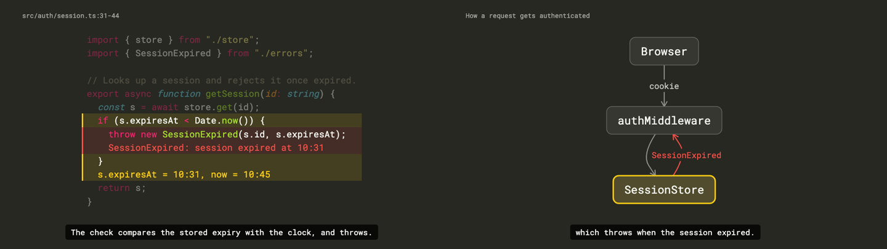

**`grape`**: Dark. Vintage grape with lime cream. Modern.

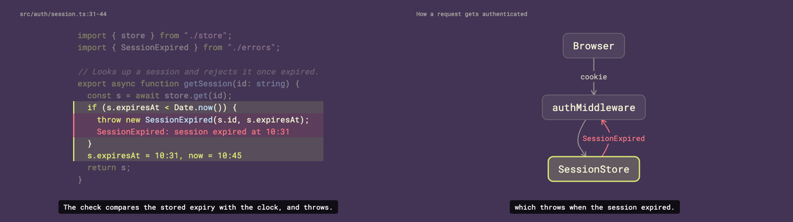

**`french-blue`**: Dark. French blue with celadon. Modern.

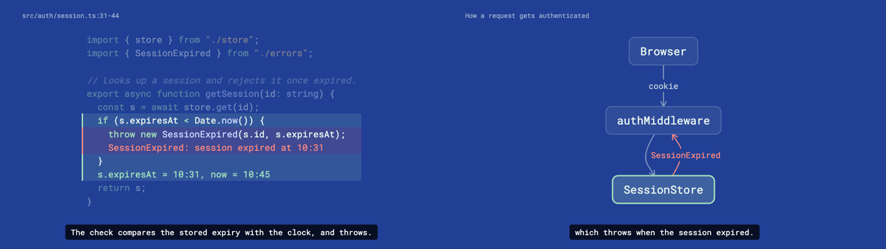

**`espresso`**: Dark. Espresso with peony. Warm.

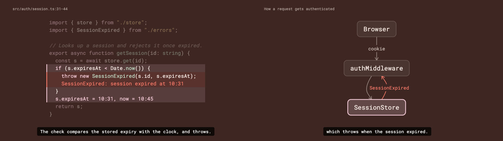

**`onyx`**: Dark. Onyx with alabaster and blue slate. Corporate.

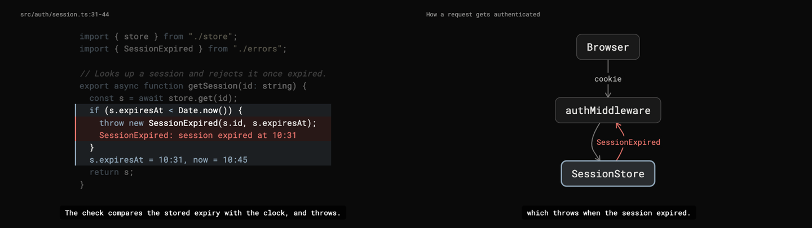

**`black-cherry`**: Dark. Black cherry with vanilla custard and old gold. Classic.

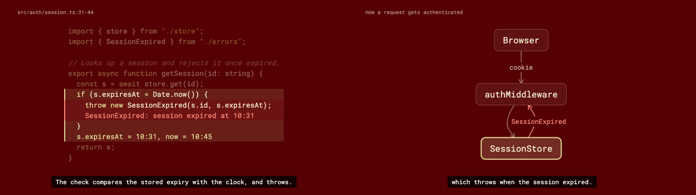

**`indigo`**: Dark. Indigo with coral and deep pink. Colourful.

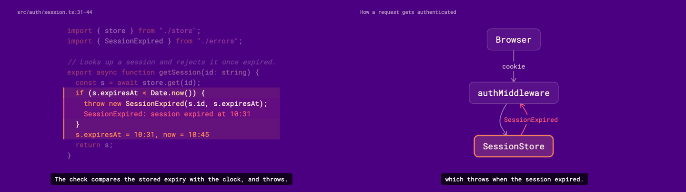

**`butter`**: Light. Morning butter with blush. Warm.

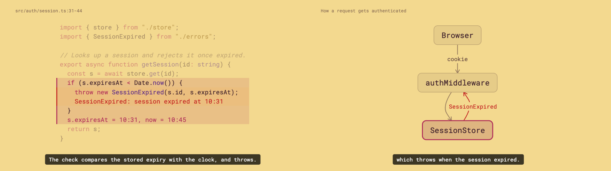

**`lavender`**: Light. Lavender blush with French blue. Corporate.

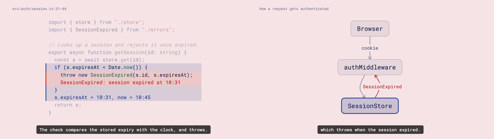

**`snow`**: Light. Bright snow with inferno and periwinkle. Corporate.

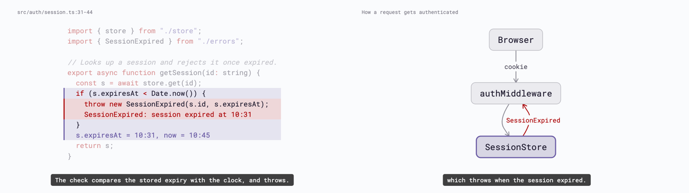

**`papaya`**: Light. Papaya whip with cool horizon and grapefruit. Colourful.

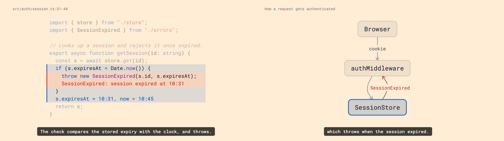

## Getting the most out of ElevenLabs

[ElevenLabs](https://elevenlabs.io) gives the best results and is the default. There are two ways to connect it.

**The ElevenLabs connector (recommended).** Connect ElevenLabs in your agent (in Claude, under connector settings). The agent then voices each beat directly, with no API key to manage. It asks for one take per beat, since the video uses only one, and prices the narration first, so it tells you the credit cost before it voices more than about ten beats. It uses the `eleven_v4` model.

**An API key.** Create a key in the ElevenLabs dashboard and give it to the agent when asked. The agent keeps it in an environment variable and never writes it to a file. This path also makes one take per beat, with `eleven_multilingual_v2` by default, and it sends the previous and next beat's text with each request, which keeps the intonation consistent across beats.

Tips:

- **Approve the outline before voicing.** Credits are spent per character of narration. Changes are cheap during the silent draft pass and expensive afterwards.
- **Change one beat at a time.** Only beats whose narration changed need new audio, so fixing one sentence costs one beat. The build stops rather than play audio that no longer matches its narration.
- **Use one path for the whole video.** The two paths use different models, so mixing them within a video changes how beats sound.
- **Use one calm narrator for the whole video,** and for every chapter of a long one. The skill picks from ElevenLabs' educational voices by default. Name a voice if you have a favourite.
- **Fix pronunciation by respelling.** If a voice mangles an identifier, the agent respells it phonetically in that beat's script and re-voices only that beat.
- **Budget for length.** One minute of narration is about 150 words, or roughly 900 characters. Check the [pricing page](https://elevenlabs.io/pricing) to see how many credits your plan includes and how many each model uses per character.

## Without an ElevenLabs account

You still get a full video.

- **Silent video with captions.** Without a key or connector, the build writes silent placeholder audio timed to the narration. The captions are burnt in, so the video can be read as it plays. This works well for async review and for drafts.
- **Another text-to-speech provider.** The skill accepts one audio file per beat from any source: OpenAI, Google Cloud, Azure or Amazon Polly. Tell the agent which one to use.
- **Free and local.** [Kokoro](https://github.com/hexgrad/kokoro) and [Piper](https://github.com/rhasspy/piper) run offline and sound good. On macOS, the built-in `say` command works with no setup, though it sounds robotic.

The agent saves each beat as `beats/NN.mp3` and converts other formats with `ffmpeg`. The rest of the pipeline stays the same. You can switch to ElevenLabs later and re-voice every beat without rebuilding anything else.

## Repository layout

```text
skills/code-explainer-video/
  SKILL.md                 the workflow: intake, research, beats, fact-check, draft, animation, voice, render
  free_audio/              a music loop and interface sounds, copied into each video project
  template/                Remotion source files copied over the official Code Hike template
    scripts/build.mjs      beats/ → audio, visuals and a manifest
    src/                   composition, diagrams, charts, captions, code marks
  references/
    voice.md               ElevenLabs connector, API key, other providers, silent fallback
    long-form.md           15-30 minute videos built as parallel chapters
docs/themes/               a screenshot of each colour theme
```

The agent scaffolds a fresh project from the official Code Hike template for each video and copies `template/` over it. The template files were last tested with Remotion 4.0.543 and dagre 3.1.3.

## License

[MIT](LICENSE). Videos you render use [Remotion](https://www.remotion.dev/license), which is free for individuals and small teams but requires a company license for larger organisations. Check whether that applies to you.

The music loop and sounds in `skills/code-explainer-video/free_audio/` were generated by the author with ElevenLabs under a commercial licence.
